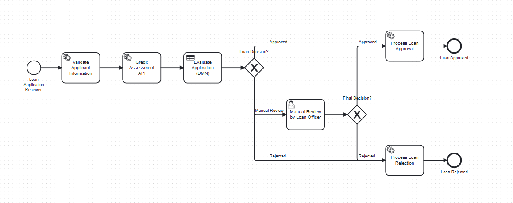
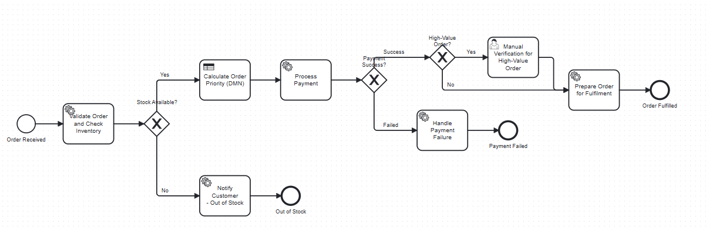
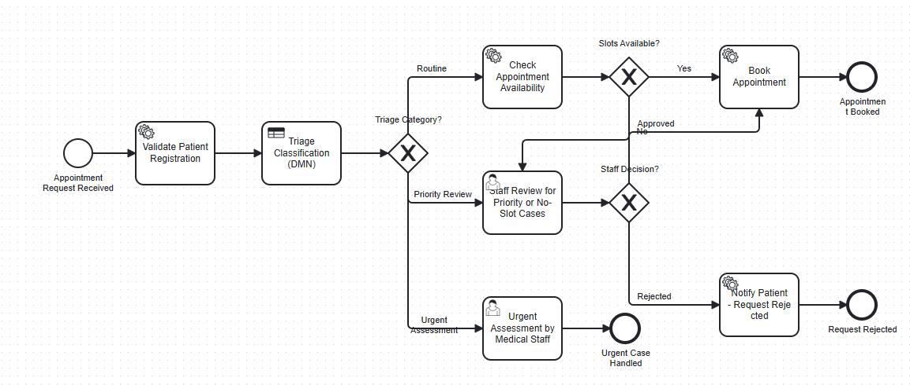

# Camunda 8: End-to-End Workflow Automation Labs

**Course:** PBJ-2 Practical Assignment  
**Repository:** [workflow-automation-labexp4](https://github.com/azezal1/workflow-automation-labexp4)  
**Platform:** Camunda 8 with Spring Boot External Workers  
**Author:** [Your Name]

---

## 📋 Table of Contents

- [Overview](#overview)
- [Lab Assignments](#lab-assignments)
- [Screenshots](#screenshots)
- [Prerequisites](#prerequisites)
- [Project Structure](#project-structure)
- [Quick Start Guide](#quick-start-guide)
- [Lab-Specific Instructions](#lab-specific-instructions)
- [Testing & Verification](#testing--verification)
- [Troubleshooting](#troubleshooting)
- [Submission Checklist](#submission-checklist)

---

## 🎯 Overview

This repository contains complete implementations for three end-to-end workflow automation labs using **Camunda 8**. Each lab demonstrates BPMN orchestration, DMN-based decisions, external job workers, REST service integration, human task management, and process monitoring with incident recovery.

### Key Technologies
- **Camunda 8** (Zeebe Process Engine)
- **Camunda Modeler** for BPMN/DMN design
- **Spring Boot 3.2.x** for external job workers
- **Java 17** runtime
- **Maven** build system
- **REST Connectors** for service integration

---

## 🧪 Lab Assignments

### Lab 1: End-to-End Loan Approval Automation
**Objective:** Build a loan approval workflow combining BPMN orchestration, DMN decisions, external validation, credit assessment API, and manual review tasks.

**Key Features:**
- ✅ Applicant information validation
- ✅ DMN-based approval/rejection/manual review logic
- ✅ REST integration for credit assessment
- ✅ Human task for manual review cases
- ✅ Incident simulation and recovery

📂 **Location:** `lab1-loan-approval/`  
📄 **Full Report:** [LAB1-REPORT.md](./lab1-loan-approval/LAB1-REPORT.md)

---

### Lab 2: End-to-End E-Commerce Order Processing
**Objective:** Develop an order processing workflow with inventory validation, priority determination, payment processing, and fulfillment routing.

**Key Features:**
- ✅ Order validation and inventory checking
- ✅ DMN-based order priority classification
- ✅ Payment gateway REST integration (mock)
- ✅ High-value order manual verification
- ✅ Exception handling for stock/payment failures

📂 **Location:** `lab2-ecommerce-order/`  
📄 **Full Report:** [LAB2-REPORT.md](./lab2-ecommerce-order/LAB2-REPORT.md)

---

### Lab 3: Hospital Appointment & Patient Triage Management
**Objective:** Create a hospital appointment workflow with patient registration, triage classification, appointment scheduling, and staff review for exceptions.

**Key Features:**
- ✅ Patient registration validation
- ✅ DMN-based triage (Routine/Priority/Urgent)
- ✅ Hospital scheduling API integration (mock)
- ✅ Staff review task for manual intervention
- ✅ Appointment availability routing

📂 **Location:** `lab3-hospital-appointment/`  
📄 **Full Report:** [LAB3-REPORT.md](./lab3-hospital-appointment/LAB3-REPORT.md)

---

## 📸 Screenshots

### Experiment 1: Loan Approval Workflow

*Figure 1: BPMN diagram showing loan approval process with validation, credit assessment, DMN decision, and manual review tasks.*

### Experiment 2: E-Commerce Order Processing

*Figure 2: Order processing workflow with inventory check, payment integration, priority determination, and fulfillment routing.*

### Experiment 3: Hospital Appointment Triage

*Figure 3: Hospital appointment workflow demonstrating patient triage, scheduling integration, and staff review mechanisms.*

---

## ⚙️ Prerequisites

Before running the labs, ensure you have:

### Required Software
1. **Camunda 8 Platform** (one of the following):
   - Camunda 8 Self-Managed (Docker Compose) - *Recommended for local development*
   - Camunda 8 SaaS Account - [Sign up here](https://camunda.com/signup/)

2. **Java Development Kit 17+**
   ```bash
   java -version  # Should show 17 or higher
   ```

3. **Apache Maven 3.9+**
   ```bash
   mvn -version
   ```

4. **Camunda Modeler 5.x**
   - Download: [https://camunda.com/download/modeler/](https://camunda.com/download/modeler/)

5. **Git** (for cloning repository)
   ```bash
   git --version
   ```

### Optional Tools
- **Postman** or **curl** for REST API testing
- **IntelliJ IDEA** or **VS Code** for Java development

---

## 📁 Project Structure

```
workflow-automation-labexp4/
├── README.md                              # This file
├── experiment1.png                        # Lab 1 screenshot
├── experiment2.png                        # Lab 2 screenshot
├── experiment3.png                        # Lab 3 screenshot
│
├── lab1-loan-approval/
│   ├── bpmn/
│   │   └── loan-approval-process.bpmn    # BPMN diagram
│   ├── dmn/
│   │   └── loan-decision.dmn             # DMN decision table
│   ├── worker/
│   │   ├── pom.xml                       # Maven dependencies
│   │   ├── src/main/java/com/camunda/lab1/
│   │   │   ├── LoanWorkerApplication.java
│   │   │   └── workers/
│   │   │       └── LoanValidationWorker.java
│   │   └── src/main/resources/
│   │       └── application.properties
│   ├── rest-examples/
│   │   └── credit-api-examples.json      # REST API samples
│   ├── process-variables.md              # Variable documentation
│   ├── test-cases.md                     # Test scenarios
│   └── LAB1-REPORT.md                    # Implementation report
│
├── lab2-ecommerce-order/
│   ├── bpmn/
│   │   └── order-processing.bpmn
│   ├── dmn/
│   │   └── order-priority.dmn
│   ├── worker/
│   │   ├── pom.xml
│   │   ├── src/main/java/com/camunda/lab2/
│   │   │   ├── OrderWorkerApplication.java
│   │   │   └── workers/
│   │   │       └── OrderValidationWorker.java
│   │   └── src/main/resources/
│   │       └── application.properties
│   ├── rest-examples/
│   │   └── payment-api-examples.json
│   ├── process-variables.md
│   ├── test-cases.md
│   └── LAB2-REPORT.md
│
└── lab3-hospital-appointment/
    ├── bpmn/
    │   └── appointment-triage.bpmn
    ├── dmn/
    │   └── triage-decision.dmn
    ├── worker/
    │   ├── pom.xml
    │   ├── src/main/java/com/camunda/lab3/
    │   │   ├── AppointmentWorkerApplication.java
    │   │   └── workers/
    │   │       └── RegistrationWorker.java
    │   └── src/main/resources/
    │       └── application.properties
    ├── rest-examples/
    │   └── scheduling-api-examples.json
    ├── process-variables.md
    ├── test-cases.md
    └── LAB3-REPORT.md
```

---

## 🚀 Quick Start Guide

### Step 1: Clone the Repository

```bash
git clone https://github.com/azezal1/workflow-automation-labexp4.git
cd workflow-automation-labexp4
```

### Step 2: Set Up Camunda 8 (Docker Compose - Recommended)

Create a `docker-compose.yml` file in the project root:

```yaml
version: '3.8'

services:
  zeebe:
    image: camunda/zeebe:8.5.0
    container_name: zeebe
    ports:
      - "26500:26500"
      - "9600:9600"
    environment:
      - ZEEBE_LOG_LEVEL=info
    volumes:
      - zeebe-data:/usr/local/zeebe/data

  operate:
    image: camunda/operate:8.5.0
    container_name: operate
    ports:
      - "8081:8080"
    environment:
      - CAMUNDA_OPERATE_ZEEBE_GATEWAYADDRESS=zeebe:26500
      - CAMUNDA_OPERATE_ELASTICSEARCH_URL=http://elasticsearch:9200
    depends_on:
      - zeebe
      - elasticsearch

  tasklist:
    image: camunda/tasklist:8.5.0
    container_name: tasklist
    ports:
      - "8082:8080"
    environment:
      - CAMUNDA_TASKLIST_ZEEBE_GATEWAYADDRESS=zeebe:26500
      - CAMUNDA_TASKLIST_ELASTICSEARCH_URL=http://elasticsearch:9200
    depends_on:
      - zeebe
      - elasticsearch

  elasticsearch:
    image: docker.elastic.co/elasticsearch/elasticsearch:8.9.0
    container_name: elasticsearch
    ports:
      - "9200:9200"
    environment:
      - discovery.type=single-node
      - xpack.security.enabled=false
      - "ES_JAVA_OPTS=-Xms512m -Xmx512m"
    volumes:
      - elasticsearch-data:/usr/share/elasticsearch/data

volumes:
  zeebe-data:
  elasticsearch-data:
```

Start Camunda 8:

```bash
docker-compose up -d
```

**Access URLs:**
- **Operate:** http://localhost:8081
- **Tasklist:** http://localhost:8082
- **Zeebe Gateway:** localhost:26500

### Step 3: Deploy BPMN and DMN Models

Using **Camunda Modeler**:

1. Open Camunda Modeler
2. File → Open → Navigate to `lab1-loan-approval/bpmn/loan-approval-process.bpmn`
3. Click **"Deploy"** button (rocket icon)
4. Configure deployment:
   - **Cluster Endpoint:** `http://localhost:26500`
   - **Authentication:** None (for local Docker setup)
5. Deploy the BPMN file
6. Repeat for DMN file: `lab1-loan-approval/dmn/loan-decision.dmn`

Repeat for Lab 2 and Lab 3 models.

### Step 4: Configure and Run Workers

For each lab, configure the worker's `application.properties`:

**Example for Lab 1:**

Edit `lab1-loan-approval/worker/src/main/resources/application.properties`:

```properties
# Zeebe Configuration
zeebe.client.broker.gateway-address=127.0.0.1:26500
zeebe.client.security.plaintext=true

# Worker Configuration
zeebe.client.worker.defaultName=loan-approval-worker
zeebe.client.worker.defaultType=loan-worker
zeebe.client.worker.threads=2

# Application
spring.application.name=loan-approval-worker
server.port=8090
```

**Build and run the worker:**

```bash
cd lab1-loan-approval/worker
mvn clean install
mvn spring-boot:run
```

The worker will connect to Zeebe and start polling for jobs.

**Repeat for Lab 2 and Lab 3 workers** (use different ports: 8091, 8092).

### Step 5: Start a Workflow Instance

**Option A: Using Camunda Modeler**
1. Open the BPMN file in Modeler
2. Click **"Start Instance"** button
3. Fill in the start form with test data
4. Submit

**Option B: Using zbctl CLI**

```bash
zbctl create instance loan-approval-process \
  --variables '{
    "applicantId": "APP001",
    "applicantName": "John Doe",
    "requestedAmount": 50000,
    "monthlyIncome": 6000,
    "employmentStatus": "EMPLOYED"
  }'
```

**Option C: Using REST API**

```bash
curl -X POST http://localhost:26500/v1/process-instances \
  -H "Content-Type: application/json" \
  -d '{
    "bpmnProcessId": "loan-approval-process",
    "variables": {
      "applicantId": "APP001",
      "applicantName": "John Doe",
      "requestedAmount": 50000,
      "monthlyIncome": 6000,
      "employmentStatus": "EMPLOYED"
    }
  }'
```

### Step 6: Monitor and Interact

1. **Operate (Monitoring):** http://localhost:8081
   - View running/completed instances
   - Inspect variables
   - Investigate incidents
   - Retry failed jobs

2. **Tasklist (Human Tasks):** http://localhost:8082
   - Claim and complete manual review tasks
   - View task forms

---

## 📚 Lab-Specific Instructions

### Lab 1: Loan Approval

**Start Instance with Test Data:**

```json
{
  "applicantId": "APP001",
  "applicantName": "Jane Smith",
  "requestedAmount": 75000,
  "monthlyIncome": 8000,
  "employmentStatus": "EMPLOYED"
}
```

**Expected Flow:**
1. Validation passes (income > 0, amount < 1M)
2. Credit API returns score (simulated: 720)
3. DMN evaluates: `Approved` (score ≥ 700, income ≥ 5000)
4. Notification sent
5. Process completes

**Testing Manual Review:**
```json
{
  "applicantId": "APP002",
  "applicantName": "Bob Johnson",
  "requestedAmount": 45000,
  "monthlyIncome": 4500,
  "employmentStatus": "EMPLOYED"
}
```
- DMN routes to `ManualReview` (income < 5000)
- Task appears in Tasklist for review

**Full Test Cases:** See [test-cases.md](./lab1-loan-approval/test-cases.md)

---

### Lab 2: E-Commerce Order

**Start Instance with Test Data:**

```json
{
  "customerRef": "CUST123",
  "productId": "P001",
  "quantity": 5,
  "deliveryPreference": "EXPRESS",
  "paymentToken": "tok_success",
  "customerCategory": "PREMIUM"
}
```

**Expected Flow:**
1. Validation passes, stock available (≤100), total calculated
2. DMN evaluates priority: `Critical` (PREMIUM + EXPRESS)
3. Payment succeeds (mock API)
4. Fulfillment order created
5. Process completes

**Testing High-Value Review:**
```json
{
  "customerRef": "CUST456",
  "productId": "P002",
  "quantity": 10,
  "deliveryPreference": "STANDARD",
  "paymentToken": "tok_success",
  "customerCategory": "GOLD"
}
```
- Order total: $1,499.90 (≥ $1000)
- Routes to manual verification task

**Full Test Cases:** See [test-cases.md](./lab2-ecommerce-order/test-cases.md)

---

### Lab 3: Hospital Appointment

**Start Instance with Test Data:**

```json
{
  "patientRef": "PAT001",
  "appointmentPreference": "GENERAL_PRACTICE",
  "symptoms": "routine checkup",
  "urgencyIndicators": ""
}
```

**Expected Flow:**
1. Registration validation passes
2. DMN evaluates triage: `Routine`
3. Scheduling API returns available slot
4. Appointment booked
5. Process completes

**Testing Urgent Case:**
```json
{
  "patientRef": "PAT002",
  "appointmentPreference": "EMERGENCY",
  "symptoms": "severe chest pain difficulty breathing",
  "urgencyIndicators": "chest pain, breathing difficulty"
}
```
- DMN routes to `UrgentAssessment`
- Immediate staff review task created

**Full Test Cases:** See [test-cases.md](./lab3-hospital-appointment/test-cases.md)

---

## ✅ Testing & Verification

### Test Coverage Requirements

Each lab requires testing:
1. ✅ **Success Path** - All validations pass, services succeed
2. ✅ **Rejection Path** - Fails business rules (DMN rejects)
3. ✅ **Manual Review Path** - Routes to human task
4. ✅ **Service Failure** - REST API error/timeout
5. ✅ **Incident Recovery** - Worker failure → fix → retry

### Incident Simulation

**Scenario:** Credit API unavailable (Lab 1)

1. Stop the credit API mock (or use invalid URL in REST connector)
2. Start instance
3. Process reaches REST connector → fails → incident created
4. **Observe in Operate:**
   - Instance state: `INCIDENT`
   - Activity: Credit assessment task shows error
   - Error message displayed
5. **Fix:** Start credit API or update connector URL
6. **Recover in Operate:**
   - Select failed instance
   - Click **"Retry"** on incident
   - Process resumes and completes

### Process Variable Inspection

In **Operate**, view process variables at each step:
- Start: `applicantId`, `requestedAmount`, etc.
- After validation: `validationPassed`, `validationMessage`
- After credit API: `creditScore`, `creditStatus`
- After DMN: `loanDecision`, `decisionReason`

---

## 🔧 Troubleshooting

### Issue: Worker not connecting to Zeebe

**Symptoms:** Worker starts but shows connection errors

**Solutions:**
1. Check Zeebe is running:
   ```bash
   docker ps | grep zeebe
   ```
2. Verify gateway address in `application.properties`:
   ```properties
   zeebe.client.broker.gateway-address=127.0.0.1:26500
   ```
3. Check firewall/network settings

---

### Issue: BPMN deployment fails

**Symptoms:** Modeler shows deployment error

**Solutions:**
1. Verify Zeebe endpoint: `http://localhost:26500`
2. Check BPMN syntax: Ensure all tasks have job types defined
3. Review Modeler logs for specific errors

---

### Issue: REST Connector fails

**Symptoms:** Incident at REST connector task

**Solutions:**
1. Check mock API is running (if using mock)
2. Verify URL in BPMN connector configuration
3. Check REST API authentication settings
4. Review Operate error message for details

---

### Issue: DMN decision returns unexpected result

**Symptoms:** Process routes to wrong path

**Solutions:**
1. Check input variable values in Operate
2. Verify DMN rules in Modeler
3. Ensure input expressions match variable names exactly
4. Test DMN table in isolation using Modeler simulation

---

### Issue: Human task not appearing in Tasklist

**Symptoms:** User task not visible

**Solutions:**
1. Check Tasklist is running: http://localhost:8082
2. Verify user task has proper assignment (candidate groups/users)
3. Clear browser cache
4. Check process instance reached user task in Operate

---

## 📦 Submission Checklist

### Required Deliverables (All Labs)

- [x] **BPMN Model Files** (`.bpmn`)
- [x] **DMN Decision Tables** (`.dmn`)
- [x] **Spring Boot Worker Source Code**
  - [x] `pom.xml` with dependencies
  - [x] Worker classes with job handlers
  - [x] `application.properties` configuration
- [x] **REST Connector Configuration**
  - [x] API endpoint examples
  - [x] Request/response samples
- [x] **Process Variables Documentation**
- [x] **Test Cases Table** (inputs, expected outcomes, actual results)
- [x] **Implementation Reports** (architecture, flow, limitations)
- [x] **Screenshots**
  - [x] BPMN diagrams
  - [x] Tasklist evidence
  - [x] Operate monitoring
  - [x] Incident recovery

### Evidence Requirements

- [x] Model deployment confirmation
- [x] Multiple workflow instances executed
- [x] Variables inspected in Operate
- [x] Human tasks completed in Tasklist
- [x] Incident created and recovered

---

## 📞 Additional Resources

- **Camunda 8 Documentation:** https://docs.camunda.io/
- **Camunda Forum:** https://forum.camunda.io/
- **BPMN 2.0 Reference:** https://www.omg.org/spec/BPMN/2.0/
- **DMN 1.3 Reference:** https://www.omg.org/spec/DMN/1.3/
- **Spring Zeebe SDK:** https://github.com/camunda-community-hub/spring-zeebe

---

## 📝 License & Attribution

This project is created for educational purposes as part of the PBJ-2 Practical Assignment.

**Repository:** https://github.com/azezal1/workflow-automation-labexp4

---

## 👤 Author

**[Your Name]**  
Student ID: [Your ID]  
Course: PBJ-2 Practical Assignment  
Institution: [Your Institution]

---

*Last Updated: January 2024*
